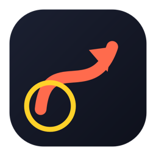
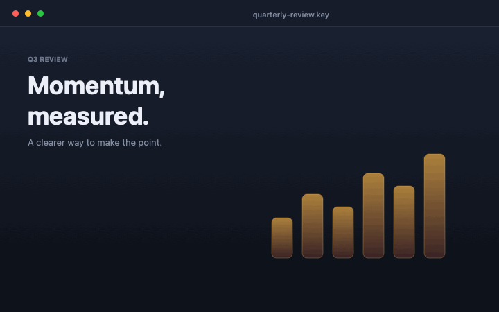

<div align="center">



# LocalInk

**Draw on anything. Interrupt nothing.**

A lightweight, offline macOS menu-bar app for drawing, highlighting, and spotlighting your screen during presentations, lessons, demos, and screen recordings.

[](https://github.com/anh-nguyenn/LocalInk/releases/latest)
[](LICENSE)
[](#compatibility)
[](https://anh-nguyenn.github.io/LocalInk/)

[Download](#download) · [Features](#features) · [Shortcuts](#keyboard-shortcuts) · [Build from source](#build-from-source) · [Website](https://anh-nguyenn.github.io/LocalInk/)

</div>

---



LocalInk puts a transparent drawing layer over your entire desktop. Toggle it on, make your point, and toggle it off — every click, drag, and scroll goes straight back to the app underneath. Core drawing and pointer effects work with no account, no network, and no screen-capture permission.

## Download

| Build | Link | Notes |
| --- | --- | --- |
| Universal ZIP | [LocalInk.zip](https://github.com/anh-nguyenn/LocalInk/releases/latest/download/LocalInk.zip) | ~0.6 MB · Apple Silicon + Intel |
| Disk image | [LocalInk.dmg](https://github.com/anh-nguyenn/LocalInk/releases/latest/download/LocalInk.dmg) | Drag to Applications |

1. Unzip the download (or open the DMG).
2. Drag **LocalInk.app** into **Applications**.
3. Open it — a small LocalInk window appears with a **Start Drawing** button.
   After that, use the pencil icon in the menu bar (or Control-Option-D).

> **First launch:** LocalInk 1.0.1 is an ad-hoc signed build and is not notarized because no Apple Developer account is available. If macOS blocks it, use **System Settings → Privacy & Security → Open Anyway** only after confirming the download came from this project's official release page. Future trusted releases require a Developer ID signed and notarized build.

## Features

### Annotate over anything
- Pen, arrow, line, rectangle, ellipse, highlighter, and text
- Solid redaction blocks and a sequential counter for step-by-step walkthroughs
- Shift-constrained squares, circles, and 45° arrow snapping
- Adjustable color, stroke width, and opacity; changes never recolor old marks
- Auto-erase after a configurable delay, or keep marks until you clear them

### Direct attention
- Cursor halo with configurable size, color, opacity, and ring-only mode
- Spotlight that dims the screen outside an aperture around the pointer
- Click ripples for visible feedback
- Halo and spotlight are click-through: the app underneath stays fully interactive

### Edit and refine
- Command-based undo and redo
- Select, move, delete, copy, and paste annotations
- With Select active, clicks on empty areas reach the app underneath; click an annotation to select or move it
- Eraser that removes marks as you drag
- Whiteboard with a separate canvas and custom background
- Floating toolbar for tools, colors, width, effects, and clear

### Zoom and share
- Cursor-following magnifier lens
- Full-screen zoom
- Annotated PNG export, clipboard copy, and SVG export
- LocalInk's own controls are excluded from captures

### Native and private
- Built with Swift and AppKit; no web runtime
- Universal binary for Apple Silicon and Intel
- No account, telemetry, analytics, or runtime network access
- Screen Recording permission is requested only for zoom and export

## Keyboard shortcuts

Global shortcuts work even when LocalInk is in the background. They can be changed in **Settings → Shortcuts**.

| Shortcut | Action |
| --- | --- |
| `⌃⌥D` | Toggle drawing |
| `⌃⌥H` | Toggle cursor halo |
| `⌃⌥L` | Toggle spotlight |
| `⌃⌥Z` | Undo |
| `⌃⌥Y` | Redo |
| `⌃⌥K` | Clear all drawings |
| `⌃⌥P` | Toggle temporary click-through |
| `⌃⌥T` | Show or hide the toolbar |

While drawing is active, these single keys select tools:

| Key | Tool | Key | Tool |
| --- | --- | --- | --- |
| `P` | Pen | `T` | Text |
| `A` | Arrow | `X` | Redact |
| `L` | Line | `N` | Counter |
| `R` | Rectangle | `E` | Eraser |
| `O` | Ellipse | `V` | Select |
| `H` | Highlighter | `C` | Cycle color |

| Key | Action |
| --- | --- |
| `[` / `]` | Decrease / increase width |
| `Delete` | Delete selection, or the last mark |
| `Escape` | Deselect, or exit drawing |
| `⌘Z` / `⇧⌘Z` | Undo / redo |
| `⌘C` / `⌘V` | Copy / paste selection |
| `⌘R` | Reset the counter |
| Hold `⌘` | Temporarily click through to the app underneath |

## How it works

LocalInk keeps one transparent, click-through panel per display and stores annotations as vector objects in each display's logical coordinates. A single state controller decides whether overlays capture the mouse:

- **Idle:** every event reaches the app underneath.
- **Halo / spotlight only:** effects follow the pointer, clicks still pass through.
- **Drawing:** overlays capture the gesture and create a mark.
- **Select:** empty areas pass clicks through; annotations accept selection and dragging.
- **Temporary pass-through:** the gesture goes to the app underneath, then drawing resumes.

The live overlay and PNG export share one renderer, and SVG uses the same geometry, so exported marks stay aligned with what you drew.

## Compatibility

- macOS 13 Ventura or later
- Apple Silicon and Intel (universal)
- Multiple displays with mixed scaling and negative origins
- Fullscreen apps and Spaces
- Works over Keynote, PowerPoint, Google Slides, Zoom, Google Meet, OBS, Figma, VS Code, PDFs, and any other app

> When sharing your screen, sharing the **entire display** generally captures overlays correctly. Sharing a single window may not include them, so check your meeting or recording app first.

## Build from source

Requirements:
- macOS 13 or later
- A full Xcode installation (recommended), or matching Xcode Command Line Tools

```bash
git clone https://github.com/anh-nguyenn/LocalInk.git
cd LocalInk
./build.sh
open dist/LocalInk.app
```

`build.sh` compiles every Swift file in `Sources/`, builds a universal binary, copies the icon and Info.plist, and ad-hoc signs the bundle. If a full Xcode installation is present, it is selected automatically.

Run the headless logic tests:

```bash
./scripts/test.sh
```

Public releases require an Apple Developer Program membership, a Developer ID Application certificate installed in your keychain, and a `notarytool` keychain profile. Create the profile once; the command prompts for an app-specific password without storing it in this repository:

```bash
/Applications/Xcode.app/Contents/Developer/usr/bin/notarytool store-credentials localink-release \
  --apple-id "you@example.com" --team-id "TEAMID"
```

Build, sign, notarize, and staple both download formats:

```bash
CODESIGN_IDENTITY="Developer ID Application: Your Name (TEAMID)" \
NOTARYTOOL_PROFILE="localink-release" ./release.sh
```

`release.sh` stops before building if either release credential is missing. It notarizes and staples the app before packaging, then signs, notarizes, and staples the DMG. It replaces the stable `LocalInk.zip` and `LocalInk.dmg` files only after both artifacts succeed. Test the downloaded files on a clean Mac before publishing them.

The current 1.0.1 release was packaged as an ad-hoc build because no Developer ID account was available yet. Use the Gatekeeper guidance above until a notarized build is published.

## Project structure

```text
Sources/
  main.swift              App entry point
  AppCoordinator.swift    Menu bar, lifecycle, actions, export flow
  ControlWindowController.swift Visible Start Drawing / controls window
  StateController.swift   Active modes and the input-capture decision
  OverlayCoordinator.swift One panel per display, undo/redo, editing commands
  DrawingOverlay.swift    Rendering and pointer input
  Annotation.swift        Vector model, tools, hit-testing
  Renderer.swift          Shared live and export renderer
  CaptureService.swift    ScreenCaptureKit permission and capture
  ExportService.swift     PNG, clipboard, and SVG composition
  LensController.swift    Magnifier and full-screen zoom
  ToolbarController.swift Floating toolbar
  SettingsController.swift Native settings window
  HotkeyManager.swift     Global Carbon shortcuts
  Preferences.swift       UserDefaults and shortcut migration
Tests/Logic/              Headless geometry and export tests
scripts/                  Icon, demo GIF, and test helpers
website/                  Static marketing site
```

## Privacy

LocalInk is designed to be local by default:

- No account, telemetry, analytics, or automatic uploads
- No network code at runtime
- Raw keystrokes, pointer histories, captured images, and clipboard contents are never logged
- Screen content is captured only when you start zoom or export, and images are written only where you choose
- Capture streams stop on quit and sleep; no capture stream is left running while zoom is off
- LocalInk's own controls are excluded from captures

## Contributing

Issues and pull requests are welcome. Please read [CONTRIBUTING.md](CONTRIBUTING.md) before opening a large change. For bug reports, include your Mac model, macOS version, and the steps to reproduce.

## License

Released under the [MIT License](LICENSE). See [CHANGELOG.md](CHANGELOG.md) for release history.

---

<div align="center">

Made by **Anh Nguyen (Jerry)**

[Website](https://anh-nguyenn.github.io/LocalInk/) · [GitHub](https://github.com/anh-nguyenn/LocalInk) · [Releases](https://github.com/anh-nguyenn/LocalInk/releases)

</div>
